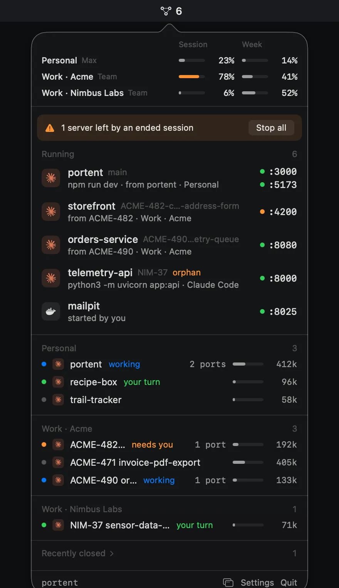

# portent releases

Downloads and public files for **[portent](https://getportent.pages.dev)**, a macOS menu bar app for developers running AI coding agents: dev servers and who started them, live Claude sessions, and Claude plan usage per account.

**[getportent.pages.dev](https://getportent.pages.dev)**: features, demo clips, pricing (7-day free trial, then €4.99 once) and FAQ.

<p align="center">
  <a href="https://getportent.pages.dev">
    <picture>
      <source media="(prefers-color-scheme: light)" srcset="assets/hero-light.webp">
      
    </picture>
  </a>
</p>

## Install

```bash
curl -fsSL https://getportent.pages.dev/install.sh | bash
```

or with Homebrew:

```bash
brew install adrianfernandezalv/tap/portent
```

or download the DMG from [Releases](https://github.com/adrianfernandezalv/portent-releases/releases) and drag portent to Applications.

Requires macOS 14 or later. portent updates itself (Sparkle); you can also check from Settings → About.

### First launch warning

portent is signed with its own certificate, not notarized by Apple. The install script and the Homebrew cask clear the quarantine flag, so it opens normally. If you installed from the DMG and macOS says it can't verify the developer, open **System Settings → Privacy & Security** and click **Open Anyway** once.

## Files

Served from [getportent.pages.dev](https://getportent.pages.dev) (Cloudflare Pages), deployed on every push to `main`. GitHub Pages (`adrianfernandezalv.github.io/portent-releases`) deploys the same files and stays on for installed apps that still read `appcast.xml` and `models.json` from there; its landing redirects to Cloudflare.

- `index.html` and `assets/`: the landing page, at [getportent.pages.dev](https://getportent.pages.dev). Clips and stills come from the app's `--demo` scenes (made-up data), recorded with `scripts/landing/record-all.sh` in the app repo.
- `appcast.xml`: Sparkle update feed, EdDSA-signed updates.
- `install.sh`: the install script above.
- `functions/`: Cloudflare Pages Functions that serve `appcast.xml` and `models.json` unchanged and count each request per day and app version (from the User-Agent) in Workers Analytics Engine. No IP or identifier is stored. `scripts/stats.sh` prints the totals.
- `models.json`: context window per model, read by the app at most once a day. Longest matching `prefix` wins; a `[1m]` model suffix means 1M tokens; when a session holds more tokens than listed, the next of `tiers` is assumed.
  Kept current by a daily workflow that reads Anthropic's [models overview](https://platform.claude.com/docs/en/about-claude/models/overview) and opens a pull request when a context window changes.
